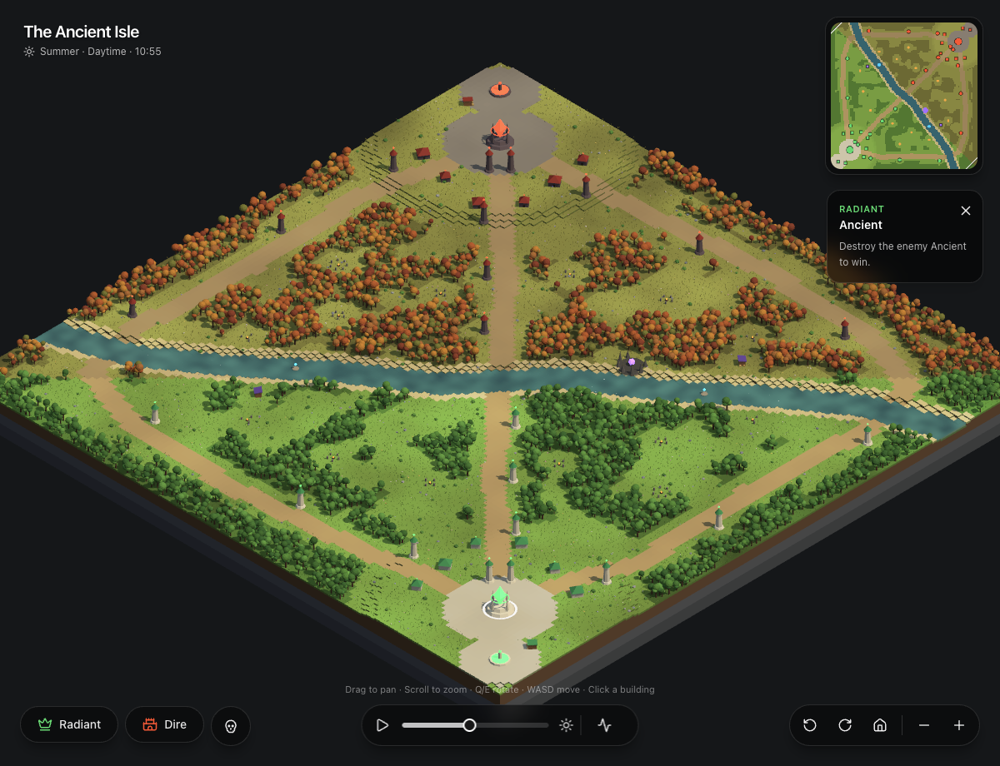

# Mobacraft

A Dota 2–style three-lane MOBA map rendered as a cozy isometric diorama in the
spirit of [Quack](https://playquack.xyz). Map milestone: explore only.



## Stack

Turborepo · Bun · React 19 · three.js r187 **WebGPU** (TSL, WebGL2 fallback) ·
Effect 4 · shadcn-style UI on react-aria-components + Tailwind 4 · oxlint · oxfmt ·
commitlint · lefthook.

## Run

```sh
bun install
bun run dev        # http://localhost:5173
make test          # format + lint + typecheck + tests (the gate)
```

## Layout

```
packages/map     generateMap(spec) → MobaMap        pure data, deterministic, tested
packages/engine  MapView (Effect service)           WebGPU renderer, input, loop, picking
packages/ui      Button/Toolbar/Slider/Tooltip       react-aria + Tailwind glass HUD kit
apps/web         composition root + HUD + minimap
spec/            game definition, architecture, visual rubric, asset plan
docs/            ADRs + design references/screenshots
```

## Controls

Drag pan · wheel zoom (to cursor) · Q/E rotate · WASD/arrows move · H home ·
click a building · minimap click/drag · time-of-day slider / play.
